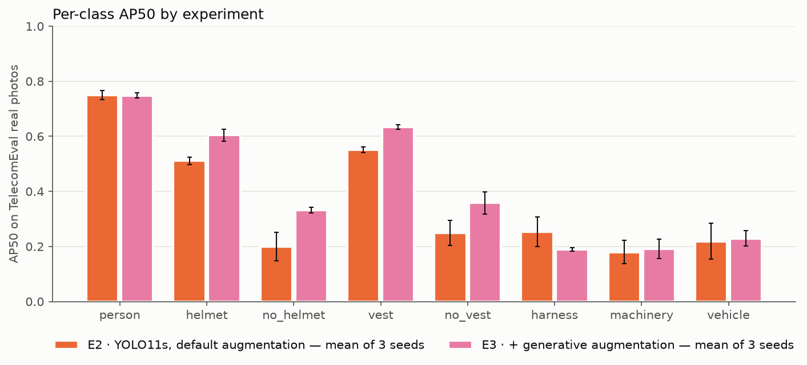

# Phase 2 results: E3 (with generated images) versus E2

> 中文版：[README.md](README.md)
> Status (2026-11-07): TelecomSynth holds 1,724 images. E3 has been trained with 3 seeds and evaluated on TelecomEval.

## Summary

Adding 1,724 generated images (TelecomSynth) to the training set raises mAP50 on TelecomEval's **real photos** from **36.4 ± 2.9%** to **41.1 ± 0.9%** (+4.7), with less spread between seeds. Most of the gain comes from the four helmet / vest classes (+8 to +13 each) and from the power-line photos (+9.2). **The headline metric, real telecom photos, rises by only 1.2 points (46.9 → 48.1), which is within the seed spread.** Of the weak classes we generated for, machinery and vehicle improve a lot on generated images but stay flat on real photos, and harness drops on real photos. Our check traced the harness drop mainly to TelecomEval's harness labels (missing labels, inconsistent conventions); the generated images' harness labels are correct.

## Setup

- **E2**: the phase 1 baseline, 6,728 training images from public data, Ultralytics' default augmentation.
- **E3**: E2's training images + TelecomSynth's 1,724 (8,452 in total), **with everything else identical to E2** ([`configs/baseline.yaml`](../../../configs/baseline.yaml): YOLO11s, 640 px, 100 epochs, patience 20). The validation set is unchanged and holds only real images.
- Each experiment was trained once with seeds 0, 1 and 2. The E3 runs stopped at epochs 98, 88 and 88.
- Test set: the frozen TelecomEval (222 images: 124 real photos, 98 generated).

| Weak class | Member | Images | How they were made |
|---|---|---|---|
| `harness` | Guo | 380 | gpt-image; boxes from detectors, classes from a vision-language model, CLIP near-repeat cut, human spot checks |
| `machinery` | LU | 350 | gpt-image; labelled by the member in Roboflow, corrected by the coordinator |
| `no_vest` | Guo 344 + Sneha 50 | 394 | Guo's part as for harness; Sneha's part labelled by hand |
| `no_helmet` | linyuxuan | 300 | Doubao (watermark cropped); labelled by the member, vehicles and machinery added by the coordinator |
| `vehicle` | mengxiangyu | 300 | generated and labelled by the member; the coordinator removed wrong boxes and fixed PPE classes |

Training instances added by TelecomSynth: vehicle +1,798 (276 real), no_helmet +1,401 (1,069 real), no_vest +1,756, helmet +1,701, vest +1,360, harness +854, machinery +555, person +3,381.

## TelecomEval results (percentages, mean ± std of 3 seeds)

| Subset | Images | E2 mAP50 | E3 mAP50 | Change | E2 mAP50-95 | E3 mAP50-95 |
|---|---|---|---|---|---|---|
| **Real photos, telecom work (headline)** | 77 | 46.9 ± 4.1 | 48.1 ± 1.7 | +1.2 | 29.4 ± 5.6 | 26.8 ± 1.2 |
| Real photos, power-line work | 47 | 26.0 ± 2.2 | 35.2 ± 0.8 | +9.2 | 10.3 ± 1.0 | 13.2 ± 0.4 |
| Real photos, all | 124 | 36.4 ± 2.9 | 41.1 ± 0.9 | +4.7 | 19.2 ± 2.9 | 19.2 ± 0.6 |
| Generated images (reference only) | 98 | 52.7 ± 1.9 | 69.3 ± 0.4 | +16.6 | 31.8 ± 1.8 | 43.2 ± 1.0 |
| All | 222 | 42.7 ± 2.1 | 53.1 ± 0.7 | +10.4 | 24.0 ± 2.1 | 29.7 ± 0.7 |

Validation set (same sources as training, for development only): E2 73.7 ± 0.7%, E3 74.6 ± 0.1% (best epoch of each seed, from the training logs). The generated images did not hurt performance on the original domain.

### Per-class AP50 on real photos

| Class | Instances | E2 | E3 | Change |
|---|---|---|---|---|
| person | 209 | 75.0 ± 1.6 | 74.8 ± 0.9 | −0.1 |
| helmet | 156 | 51.1 ± 1.4 | 60.4 ± 2.1 | **+9.3** |
| no_helmet | 49 | 19.9 ± 5.1 | 33.2 ± 1.0 | **+13.3** |
| vest | 93 | 55.1 ± 1.1 | 63.4 ± 0.7 | **+8.3** |
| no_vest | 108 | 24.9 ± 4.5 | 35.9 ± 4.0 | **+10.9** |
| harness | 58 | 25.4 ± 5.4 | 18.9 ± 0.7 | **−6.5** |
| machinery | 50 | 18.0 ± 4.2 | 19.1 ± 3.5 | +1.1 |
| vehicle | 42 | 21.9 ± 6.6 | 23.0 ± 2.8 | +1.1 |

Per-class figures for every subset: [`per_class_by_subset.csv`](telecom_eval/per_class_by_subset.csv). Full subset results: [`telecom_eval/results-EN.md`](telecom_eval/results-EN.md).

## Reading the results

1. **The four helmet and vest classes improve steadily on real photos.** All three E3 seeds score above all three E2 seeds, and the telecom and power-line subsets move in the same direction.
2. **Machinery and vehicle rise on generated images but stay flat on real photos.** They gain 29.3 and 37.4 points on generated images but only 1.1 on real photos. The model may have learned the generators' style rather than how these objects look in real scenes. The real telecom photos contain only 12 vehicle and 17 machinery instances, so the headline subset says almost nothing about these two classes.
3. **Harness drops on real photos (25.4 → 18.9), but this is mostly a measurement problem, not wrong labels in the generated images.** See the next section.
4. **The gain on the headline metric is not significant.** Real telecom photos gain 1.2 points, less than E2's seed standard deviation (4.1). Most of the +4.7 on all real photos comes from the power-line photos.
5. **mAP50-95 on real photos does not improve** (19.2 → 19.2), so box placement did not get tighter. This may be because the generated images' boxes fit less tightly (not verified).

## Why harness dropped

We matched every harness prediction (confidence ≥ 0.25) of the six E2 and E3 models against the TelecomEval labels, and spot-checked the harness labels in the generated images.

1. **E3 still finds harnesses.** On real photos, E2 and E3 hit the same number of harnesses (13–15 on telecom photos), and the most they can find at any confidence is also the same (19–21).
2. **The generated images' harness labels are correct.** In a random sample of 50 of Guo's harness boxes, every person really wears a full-body harness and nothing is labelled wrongly; about 6 boxes are a little narrow or off-centre. In 25 sampled people without a harness label, none wears one. E3 reports harnesses on clearly unharnessed people no more often (0–2 people) than E2 (1–2).
3. **TelecomEval's harness labels on real photos have two problems that lower every model's score:**
   - **Missing labels:** of the 32 people the models report a harness on without a harness label, 20 clearly wear a harness or a lineman's body belt (19 in the photos supplied by Guo, 1 in Lu's), 6 do not, and 6 cannot be judged. Each of these correct detections is counted as a false positive.
   - **Inconsistent conventions:** in Lu's photos, linemen's body belts are labelled as thin boxes around the waist (11 in `lu_046` alone, nearly a fifth of the 58 harness boxes on real photos). The other photos and the training data label full-body harnesses from the shoulders to the thighs. No model's boxes can match these thin boxes.
4. **Without these two problems, the gap shrinks but remains:** ignoring predictions on the 20 people and dropping the belt boxes of `lu_046`, harness AP50 is 36.7 ± 4.9 for E2 and 32.4 ± 1.4 for E3 (−4.3, within E2's seed spread). E2's reported mean is lifted by one high seed (seed 0: 30.9).
5. **The remaining gap has two sources:**
   - **Telecom photos: box fit.** With the match threshold relaxed to IoU 0.3 the two are level (E2 62.4, E3 63.0). E3 finds the harnesses, but its boxes are slightly narrower, so a few miss IoU 0.5.
   - **Power-line photos:** these have only 17 harness boxes, most of them belts. E3 more readily reports harnesses on distant, blurry linemen (1–3 people per seed, too unclear to judge).

**Recommendation:** the generated images need no change. TelecomEval's harness labels should be revised: add the 20 missing people and settle one convention for belts. Because TelecomEval is frozen, the revision should be frozen as a new version, and both E2 and E3 evaluated again. Until then, the harness figures on real photos should not be used as a conclusion.

## Known issues and limits

- **TelecomEval freeze check:** 10 of Lu's JPEGs (`lu_039`–`045`, `lu_055`–`057`) lacked the end-of-image marker. During the first phase 1 evaluation, one minute after the freeze, Ultralytics rotated them by their EXIF orientation and saved them again in place, so their hashes no longer match the frozen manifest. The original files match the frozen hashes; the re-saved images differ by at most 4/255 per pixel, and the labels are unchanged. The phase 1 figures were already computed on the re-saved files, and re-evaluating E2 now reproduces them exactly. This evaluation therefore skipped the freeze check. The manifest was then regenerated from the current files (only these 10 lines and the total hash changed; new total hash `4a4f90ec…`), and the check passes again.
- **Incomplete source records:** mengxiangyu (300 images) and Sneha (50) did not supply prompts; their model and prompt fields in `sources.csv` read `PENDING`.
- **Mixed labelling methods:** harness and Guo's no_vest images were labelled automatically with human spot checks; the rest were labelled by hand. Passers-by in the generated images are labelled `person` only (the phase 2 rule); TelecomEval keeps the phase 1 rules.
- Some classes have few instances in the real photos (real telecom photos: 12 vehicles, 17 machinery), so single-class figures vary a lot.
