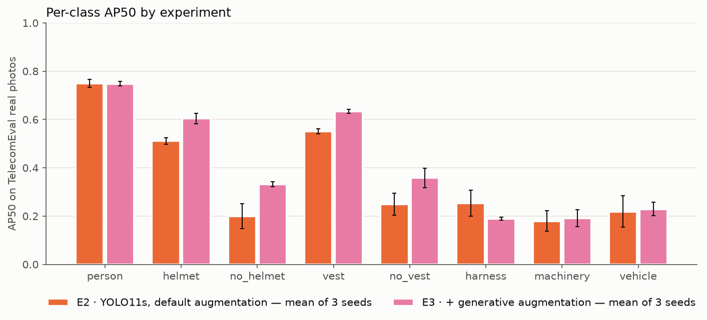

# 阶段二结果：E3（加入生成图）对比 E2

> English version: [README-EN.md](README-EN.md)
> 状态（2026-11-07）：TelecomSynth 共 1,724 张，E3 已用 3 个种子训练完毕并在 TelecomEval 上评测。

## 一句话结论

在训练集里加入 1,724 张生成图（TelecomSynth）后，E3 在 TelecomEval **真实照片**上的 mAP50 从 **36.4 ± 2.9%** 升到 **41.1 ± 0.9%**（+4.7），种子间波动也变小了。提升主要来自安全帽 / 反光衣四个类别（各 +8 到 +13）和电力线路作业照片（+9.2）。**主指标"真实照片 · 电信作业"只升了 1.2 个点（46.9 → 48.1），在种子波动范围内**。三个生成目标弱类中，机械和车辆只在生成图上大涨，真实照片上基本持平；安全带在真实照片上反而下降，但核查发现这主要是 TelecomEval 安全带标注的问题（漏标、标法不一致），生成图的安全带标注是对的。

## 实验设置

- **E2**：阶段一 baseline，公开数据 6,728 张训练图，Ultralytics 默认增广。
- **E3**：E2 的训练图 + TelecomSynth 1,724 张（共 8,452 张），**其他配置与 E2 完全相同**（[`configs/baseline.yaml`](../../../configs/baseline.yaml)，YOLO11s，640px，100 epoch，patience 20）。验证集不变，只含真实图。
- 两组都用种子 0 / 1 / 2 各训练一次；E3 分别在第 98、88、88 轮结束。
- 评测集：冻结的 TelecomEval（222 张，其中真实照片 124 张、生成图 98 张）。

| 弱类别 | 组员 | 张数 | 生成方式 |
|---|---|---|---|
| `harness` | Guo | 380 | gpt-image 生成，检测器出框 + 视觉大模型判类，CLIP 去近似重复，人工抽检 |
| `machinery` | LU | 350 | gpt-image 生成，组员在 Roboflow 标注，负责人修正 |
| `no_vest` | Guo 344 + Sneha 50 | 394 | Guo 部分同 harness；Sneha 部分为组员手工标注 |
| `no_helmet` | linyuxuan | 300 | 豆包生成（已裁掉水印），组员标注，负责人补标车辆 / 机械 |
| `vehicle` | mengxiangyu | 300 | 组员生成并标注，负责人删除误标、修正 PPE 类别 |

TelecomSynth 给各类增加的训练实例：车辆 +1,798（真实 276）、未戴安全帽 +1,401（真实 1,069）、未穿反光衣 +1,756、安全帽 +1,701、反光衣 +1,360、安全带 +854、机械 +555、人员 +3,381。

## TelecomEval 结果（百分比，3 个种子的均值 ± 标准差）

| 子集 | 张数 | E2 mAP50 | E3 mAP50 | 变化 | E2 mAP50-95 | E3 mAP50-95 |
|---|---|---|---|---|---|---|
| **真实照片 · 电信作业（主指标）** | 77 | 46.9 ± 4.1 | 48.1 ± 1.7 | +1.2 | 29.4 ± 5.6 | 26.8 ± 1.2 |
| 真实照片 · 电力线路作业 | 47 | 26.0 ± 2.2 | 35.2 ± 0.8 | +9.2 | 10.3 ± 1.0 | 13.2 ± 0.4 |
| 真实照片 · 合计 | 124 | 36.4 ± 2.9 | 41.1 ± 0.9 | +4.7 | 19.2 ± 2.9 | 19.2 ± 0.6 |
| 生成图（仅供参考） | 98 | 52.7 ± 1.9 | 69.3 ± 0.4 | +16.6 | 31.8 ± 1.8 | 43.2 ± 1.0 |
| 全部 | 222 | 42.7 ± 2.1 | 53.1 ± 0.7 | +10.4 | 24.0 ± 2.1 | 29.7 ± 0.7 |

验证集（与训练集同源，仅作开发参考）：E2 73.7 ± 0.7%，E3 74.6 ± 0.1%（取各种子最佳轮次的训练日志），说明加入生成图没有损害原领域的表现。

### 真实照片上的分类别 AP50

| 类别 | 实例数 | E2 | E3 | 变化 |
|---|---|---|---|---|
| person | 209 | 75.0 ± 1.6 | 74.8 ± 0.9 | −0.1 |
| helmet | 156 | 51.1 ± 1.4 | 60.4 ± 2.1 | **+9.3** |
| no_helmet | 49 | 19.9 ± 5.1 | 33.2 ± 1.0 | **+13.3** |
| vest | 93 | 55.1 ± 1.1 | 63.4 ± 0.7 | **+8.3** |
| no_vest | 108 | 24.9 ± 4.5 | 35.9 ± 4.0 | **+10.9** |
| harness | 58 | 25.4 ± 5.4 | 18.9 ± 0.7 | **−6.5** |
| machinery | 50 | 18.0 ± 4.2 | 19.1 ± 3.5 | +1.1 |
| vehicle | 42 | 21.9 ± 6.6 | 23.0 ± 2.8 | +1.1 |

各子集的分类别数字见 [`per_class_by_subset.csv`](telecom_eval/per_class_by_subset.csv)，完整子集结果见 [`telecom_eval/results.md`](telecom_eval/results.md)。

## 解读

1. **安全帽和反光衣四类在真实照片上稳定提升。** E3 三个种子的结果都高于 E2 的三个种子，电信和电力线路两个子集方向一致。
2. **机械和车辆是"生成图上涨、真实照片持平"。** 在生成图上分别 +29.3 和 +37.4，在真实照片上只有 +1.1。这说明模型可能学到了生成图的风格，而不是真实场景里这两类的外观。注意真实电信照片里车辆只有 12 个实例、机械 17 个，这两类在主指标子集上的数字几乎没有统计意义。
3. **安全带在真实照片上下降（25.4 → 18.9），但主要是测量问题，不是生成图标错了。** 详见下一节。
4. **主指标的提升不显著。** 电信作业真实照片 +1.2，小于 E2 的种子标准差（4.1）。真实照片合计的 +4.7 主要来自电力线路照片。
5. **mAP50-95 在真实照片上没有提升**（19.2 → 19.2），框的位置精度没有改善，可能与生成图标注框不够贴合有关（未验证）。

## 安全带为什么下降

把 E2、E3 共 6 个模型在 TelecomEval 上的安全带预测逐个和标注对照（置信度 ≥ 0.25），并抽查了生成图的安全带标注，结论如下。

1. **E3 没有"看不见"安全带。** 真实照片里，E2 和 E3 命中的安全带数量相同（电信照片 13–15 个），在任意置信度下能检出的上限也相同（19–21 个）。
2. **生成图的安全带标注是对的。** 随机抽查 Guo 的 50 个安全带框：人身上都确实系着全身式安全带，没有误标，约 6 个框偏窄或偏移。另抽 25 个没标安全带的人，也确实都没系。E3 在明显没系安全带的人身上的误报（0–2 人）也不比 E2（1–2 人）多。
3. **TelecomEval 真实照片的安全带标注有两个问题，拉低了所有模型的分数：**
   - **漏标：** 被模型报出安全带、但没有标注的 32 个人里，有 20 人明显系着安全带或线路工腰带（19 人在 Guo 提供的照片里，1 人在 Lu 的），6 人确实没系，6 人看不清。这些正确的检出都被算成了误报。
   - **标法不一致：** Lu 的照片里，线路工的腰带被标成腰部的细长框（`lu_046` 一张图就有 11 个，占真实照片全部 58 个安全带框的近 1/5）。其他照片和训练数据都标全身式安全带（从肩到大腿）。任何模型的框都匹配不上这种细长框。
4. **把这两点排除后，差距缩小但仍在：** 忽略这 20 人身上的预测、并去掉 `lu_046` 的腰带框后，安全带 AP50 为 E2 36.7 ± 4.9、E3 32.4 ± 1.4（差 −4.3，在 E2 的种子波动范围内）。原报告 E2 的均值被一个偏高的种子（种子 0 为 30.9）拉高了。
5. **剩下的差距来自两处：**
   - **电信照片：框的贴合度。** 把匹配阈值放宽到 IoU 0.3 时，两者持平（E2 62.4、E3 63.0）。E3 能找到安全带，只是框略窄，在 IoU 0.5 下少算了几个。
   - **电力线路照片：** 只有 17 个安全带框，而且多数是腰带。E3 更容易在远处、模糊的线路工身上报出安全带（每个种子 1–3 人，看不清是否系着）。

**建议：** 生成图本身不需要改。TelecomEval 的安全带标注应该修订：补上漏标的 20 人，统一腰带的标法。由于 TelecomEval 已冻结，修订后应作为新版本重新冻结，并把 E2、E3 都重新评测一遍。修订前，安全带这一类在真实照片上的数字不宜作为结论。

## 已知问题与限制

- **TelecomEval 冻结检查：** Lu 的 10 张 JPEG（`lu_039`–`045`、`lu_055`–`057`）原文件缺少结束标记，阶段一第一次评测时 Ultralytics 按 EXIF 方向转正后原地重新保存了它们（冻结后一分钟），所以哈希与冻结清单不一致。原始文件与冻结哈希一致，重存后像素最大差 4/255，标注未变；阶段一的数字本来就是在重存后的文件上算的，本次重评 E2 的结果与阶段一完全一致。本次评测因此跳过了冻结检查；之后已按现有文件重新生成冻结清单（只改了这 10 行和总哈希，新总哈希 `4a4f90ec…`），检查恢复通过。
- **来源记录不全：** mengxiangyu（300 张）和 Sneha（50 张）没有提供提示词，`sources.csv` 中的模型名和提示词暂记为 `PENDING`。
- **标注方式不统一：** harness 和 Guo 的 no_vest 为自动标注加人工抽检，其余为组员手工标注。生成图里的路人只标 `person`（阶段二规则），TelecomEval 沿用阶段一规则。
- 真实照片中部分类别实例很少（真实电信照片：车辆 12、机械 17），单类数字的波动大。
