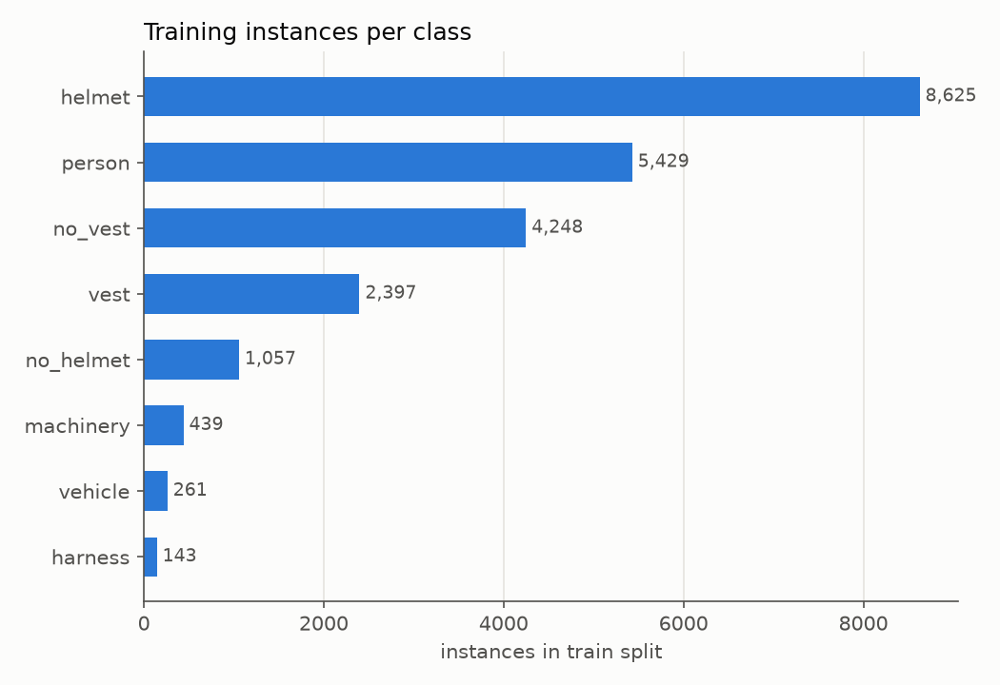
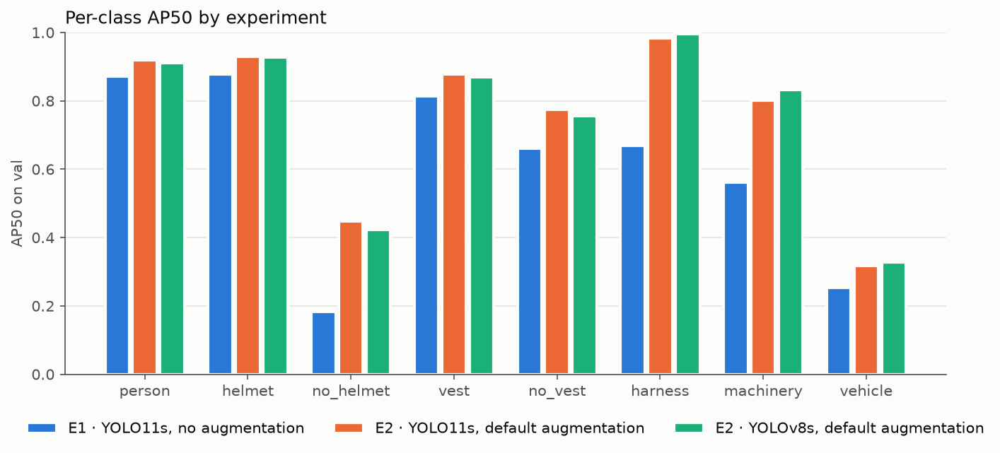
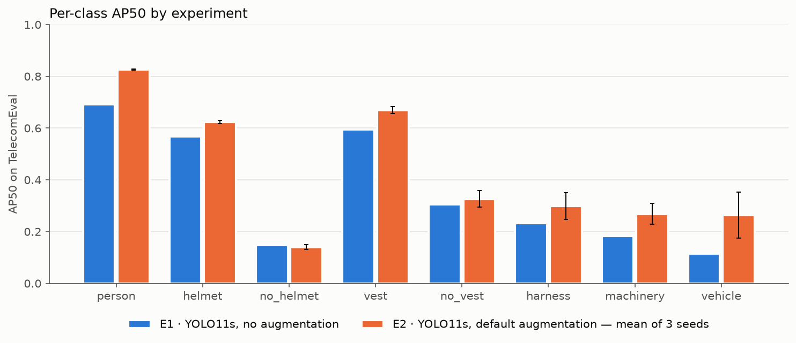

# Phase 1 Results · Baseline Demo v1

> 中文版：[README.md](README.md)
> Status (2026-10-23): baseline **v2** is frozen (tag `phase1-baseline-v2`); rule judgement and Demo v1 are done. **TelecomEval is frozen (222 images) and evaluated**; see "TelecomEval evaluation" below.
> The metrics under "Experiments" are on the **validation split**, which shares sources with training: optimistic, for development reference only. TelecomEval is the authoritative result.
> The v1 report files (2026-09-29, 5 datasets, one seed) are kept in [`v1/`](v1/).

## In one sentence

A YOLO11s baseline trained on 7,475 de-duplicated images from 6 public datasets reaches mAP50 = **0.737 ± 0.007** on the validation split (E2, 3 random seeds); Ultralytics' default conventional augmentation beats no augmentation at all (E1, 0.596) by **+14 points**, improving all 8 classes. Adding the Work at Height dataset raises harness training instances from 143 to 2,619, reaching AP50 0.81 on validation, and harnesses now start to be detected on the 167 telecom construction candidates (v1: 0 images, v2: 26). On the frozen TelecomEval, E2 reaches mAP50 **42.7 ± 2.1%** (real telecom photos **46.9 ± 4.1%**; E1 33.4%), a clear domain gap from the validation split. The weakest class is no_helmet (14.1%), followed by vehicle, machinery and harness (26–30%) — the first targets for phase 2's generative augmentation.

## Data

- Dataset sources, links, licences and actual counts: [`data/README-EN.md`](../../data/README-EN.md)
- Statistics: [`dataset_stats.csv`](dataset_stats.csv) ｜ Annotation coverage: [`coverage.csv`](coverage.csv) ｜ Licences: [`dataset_licences.csv`](dataset_licences.csv)

| Dataset | Train / val | Main contribution |
|---|---|---|
| Construction Site Safety (Roboflow v30, un-augmented) | 615 / 68 | All 7 classes; the only source of labelled vehicles |
| APD (shared with us, internal training only) | 2,005 / 223 | No vest (real sites in China) |
| **Work at Height Safety** (Roboflow v1, new in v2) | 1,776 / 197 | **Harness** (main source), aerial work platforms (machinery) |
| Ultralytics Construction-PPE | 1,187 / 132 | Person, helmet, vest |
| construction safety v2 | 1,006 / 112 | Person, helmet |
| body_harness | 139 / 15 | Harness |

- Only Work at Height images that contain a harness are used, minus 862 suspected mirror-padded images ([`configs/exclude/work_at_height.txt`](../../configs/exclude/work_at_height.txt)); see "Problems found and fixed" below.
- De-duplication (pHash) removed 1,059 images, mostly adjacent video frames and duplicates across splits. Every TelecomEval image was pHash-compared with the training set when it was merged, and near-duplicates were refused (38 images in one member's first submission), so the training set needs no change.
- Classes a dataset did not annotate were filled in by a teacher model; pseudo-labels make up **18.7%** of all boxes (6,493 / 34,785).



## Experiments (validation split, 747 images)

| Experiment | Training data | Seeds | mAP50 | mAP50-95 | Precision | Recall |
|---|---|---|---|---|---|---|
| E1 | Public data, all built-in augmentation off | 1 | 0.596 | 0.326 | 0.718 | 0.560 |
| E2 | Public data + Ultralytics default conventional augmentation | 3 | **0.737 ± 0.007** | **0.451 ± 0.002** | 0.787 ± 0.013 | 0.685 ± 0.014 |

Training configuration: [`configs/baseline.yaml`](../../configs/baseline.yaml) (YOLO11s, 640 px, up to 100 epochs, patience 20). E2 was trained once each with seeds 0 / 1 / 2, ending at epochs 89, 79 and 100; E1 stopped early at epoch 41. Summary: [`summary.csv`](summary.csv) ｜ Per-class results: [`per_class_ap.csv`](per_class_ap.csv)

| Class | Training instances | E1 AP50 | E2 AP50 (3 seeds) |
|---|---|---|---|
| person | 8,458 | 0.849 | 0.926 ± 0.002 |
| helmet | 11,640 | 0.860 | 0.908 ± 0.001 |
| vest | 2,393 | 0.766 | 0.837 ± 0.004 |
| harness | 2,619 | 0.583 | 0.814 ± 0.006 |
| no_vest | 4,234 | 0.623 | 0.801 ± 0.010 |
| machinery | 762 | 0.515 | 0.797 ± 0.014 |
| no_helmet | 1,047 | 0.271 | 0.417 ± 0.009 |
| vehicle | 244 | 0.296 | 0.399 ± 0.047 |



Confusion matrices: [E1](e1_confusion_matrix.png) ｜ [E2](e2_confusion_matrix.png)

- **Little variation between seeds**: E2's mAP50 standard deviation is only 0.7 points. Phase 2's TG3 criterion "E3 ≥ E2 + 2.0 mAP" is about three standard deviations, so passing it can be attributed to the method.
- **Not directly comparable with v1**: v1's E2 scored 0.756, but the validation split is composed differently (v2 adds Work at Height validation images), so overall numbers cannot be compared.

### Input size trial: 640 vs 960 (before freezing)

Same data, configuration and seed (0), with only the input size changed to 960 (`python -m telecomsafe.train --exp e2 --imgsz 960 --name e2_960`).

| Input size | mAP50 | mAP50-95 | Training time |
|---|---|---|---|
| **640 (adopted)** | 0.741 | 0.449 | **1.2 h** |
| 960 | 0.748 | 0.451 | 2.3 h |

- The overall gap is within single-seed variation. 960 was tried for small objects, but no_helmet gains only 0.009, while no_vest (−0.03) and harness (−0.02) drop slightly. Vehicle +0.09 rests on only 33 validation instances.
- Twice the training time and slower inference. **Conclusion: keep 640**; `configs/baseline.yaml` is unchanged.

### Model choice: YOLO11s vs YOLOv8s (v1 data)

> These two sections were run on the v1 data (5,537 images, without Work at Height). Their conclusions decide the model; their numbers are not compared with the v2 results above.

Same data, configuration and random seed as E2; the only variable is the architecture.

| Model | mAP50 | mAP50-95 | Precision | Recall | Parameters | Weights | GPU inference* | CPU inference* |
|---|---|---|---|---|---|---|---|---|
| **YOLO11s (E2, adopted)** | **0.756** | **0.499** | 0.825 | 0.711 | 9.4 M | 19.2 MB | ~15 ms | **~130 ms** |
| YOLOv8s | 0.755 | 0.494 | 0.813 | 0.736 | 11.1 M | 22.5 MB | **~12 ms** | ~154 ms |

\* RTX 4070 SUPER / local CPU, PyTorch single-image inference including pre- and post-processing; GPU averaged over 200 validation images (measured twice in swapped order, with consistent results), CPU over 100. Measured in the same session as YOLO11m in the next section. YOLOv8s stopped early at epoch 78. Confusion matrix: [YOLOv8s](v1_e2_yolov8s_confusion_matrix.png)

- **Accuracy is a tie**: mAP50 differs by 0.001 and mAP50-95 by 0.005, normal variation for a single seed. Per class it goes both ways: YOLOv8s is ~0.03 higher on machinery, YOLO11s ~0.02 higher on no_helmet and no_vest.
- **YOLO11s is smaller and faster on CPU**: 15% fewer parameters (9.43 M vs 11.14 M) and ~16% faster CPU inference, better suited to on-site deployment without a GPU. On GPU YOLOv8s is ~2 ms faster, because YOLO11's attention block costs slightly more in PyTorch; both are far below the Demo's 3-second requirement.
- **Conclusion**: keep YOLO11s as the baseline. The YOLOv8s result also shows that the phase 1 conclusions do not depend on a particular architecture.

### Model size: YOLO11s vs YOLO11m (v1 data)

Same method: data, configuration and seed identical to E2, only the model switched to YOLO11m, trained to early stopping like the others.

| Model | mAP50 | mAP50-95 | Precision | Recall | Parameters | Weights | GPU inference* | CPU inference* | Training time |
|---|---|---|---|---|---|---|---|---|---|
| **YOLO11s (E2, adopted)** | 0.756 | **0.499** | 0.825 | 0.711 | **9.4 M** | **19.2 MB** | **~15 ms** | **~130 ms** | **0.9 h** (early stop at epoch 90) |
| YOLO11m | **0.773** | 0.491 | 0.826 | 0.720 | 20.1 M | 40.5 MB | ~16 ms | ~358 ms | 1.5 h (early stop at epoch 86) |

\* Measured as in the previous section, all three models in the same session. Confusion matrix: [YOLO11m](v1_e2_yolo11m_confusion_matrix.png)

Per-class AP50 (11m − 11s): no_helmet **+0.049**, vehicle **+0.058**, vest +0.012, harness +0.011, helmet +0.009, no_vest +0.006, person 0.000, machinery **−0.013** (mAP50-95 −0.057).

- **mAP50 is 1.6 points higher, but the gain sits in the two smallest classes**: vehicle has only 6 validation images with 17 instances; no_helmet has 106 instances, so its gain is more credible. The other 6 classes are essentially level.
- **The stricter mAP50-95 is 0.8 points lower**, with machinery clearly worse.
- **Twice the cost**: 2.1× the parameters and weight size, 2.8× slower on CPU, 1.7× the training time.
- **Conclusion**: keep YOLO11s. 11m's small-object gain prompted the 960 trial above, which was not adopted.

## Demo v1

```
python -m telecomsafe.demo.app --weights runs/phase1/e2/weights/best.pt
```

Screenshots: [high-risk example](demo_ui_high_risk.png) ｜ [medium-risk example](demo_ui_medium_risk.png)

Detection → rule judgement → risk level, 0.5–1.4 s per image (RTX 4070 SUPER, model warmed up at start). Example image sources and licences: [`demo_examples/ATTRIBUTION-EN.md`](demo_examples/ATTRIBUTION-EN.md); none were used in training. Results use the v2 weights (E2, seed 0) at confidence threshold 0.35.

| Case | Expected | Actual | Result |
|---|---|---|---|
| Compliant work (telecom construction) | Low | Low · no violations | [screenshot](demo_results/1_compliant.jpg) |
| No helmet | Medium | Medium (R1, R2) | [screenshot](demo_results/2_no_helmet.jpg) |
| Person near operating machinery | High | High (R4) | [screenshot](demo_results/3_near_machinery.jpg) |
| Pole work without a hi-vis vest | Low | Low · no violations; no_vest (detected by v1) and harness (confidence 0.22) are both below the threshold | [screenshot](demo_results/4_no_vest_on_pole.jpg) |
| **Failure case**: pole climber without a helmet, wearing a harness | Medium | Low · no violations; no_helmet missed, harness only at confidence 0.20 | [screenshot](demo_results/5_failure_pole_climber.jpg) |

## TelecomEval evaluation (frozen, 222 images)

TelecomEval was frozen on 2026-10-23 ([`splits/telecom_eval.sha256`](../../splits/telecom_eval.sha256), total hash `36432926…`). It was contributed by 5 team members; each image's contributor, source, licence and real / generated status are recorded in `data/raw/telecom_eval/sources.csv`, and file names end in `__<contributor>`. All figures below are **percentages**; E2 is the mean ± standard deviation of 3 seeds. **Real telecom photos are the headline figure**; generated images are reported separately and never in their place. Full results: [`telecom_eval/results.md`](telecom_eval/results.md).

| Subset | Images | E1 mAP50 | E2 mAP50 | E2 mAP50-95 |
|---|---|---|---|---|
| **Real photos · telecom work** | 77 | 33.4 | **46.9 ± 4.1** | 29.4 ± 5.6 |
| Real photos · power-line work | 47 | 22.2 | 26.0 ± 2.2 | 10.3 ± 1.0 |
| Real photos · all | 124 | 28.8 | 36.4 ± 2.9 | 19.2 ± 2.9 |
| Generated images | 98 | 45.2 | 52.7 ± 1.9 | 31.8 ± 1.8 |
| **All of TelecomEval** | 222 | 35.5 | **42.7 ± 2.1** | 24.0 ± 2.1 |

| Class (all 222 images, AP50 %) | person | vest | helmet | no_vest | harness | machinery | vehicle | no_helmet |
|---|---|---|---|---|---|---|---|---|
| E1 | 69.3 | 59.4 | 56.8 | 30.6 | 23.3 | 18.3 | 11.4 | 14.8 |
| E2 | 82.6 | 66.9 | 62.4 | 32.7 | 29.9 | 26.9 | 26.4 | 14.1 |



- **A clear domain gap**: E2 scores 73.7% on the validation split (building sites) but 42.7% on TelecomEval and 46.9% on real telecom photos.
- **Conventional augmentation still helps**: E2 beats E1 on every subset, most on real telecom photos (+13.5 points).
- **Power-line work is the hardest** (26.0%): workers in bucket trucks or far up poles are small and often missed.
- **Generated images are easier than real photos** (52.7% vs 36.4%), so they are only a supplement.

## Weak classes (phase 2 generation targets)

From TelecomEval ([`telecom_eval/weak_classes.md`](telecom_eval/weak_classes.md), in Chinese). Generation priority: **no_helmet > vehicle ≈ machinery (bucket trucks, cable-pulling rigs, cable-drum trailers) > harness in telecom scenes > no_vest**. The earlier list from the validation split is in [`weak_classes-EN.md`](weak_classes-EN.md).

## Problems found and fixed along the way

- **Labels that contradict the dataset name**: what harness (vgg2coco) labels as "harness" is actually hi-vis vests → dropped.
- **Augmentation baked into a dataset**: the Kaggle version of Construction Site Safety (= Roboflow v28) has a training split made entirely of mosaics, so E1 was no longer a "no augmentation" control and the rules judged people and machines in different tiles as adjacent → switched to the un-augmented v30 and retrained teacher, E1 and E2. E2 mAP50 was 0.869 before the fix and 0.756 after; the difference was inflation from the mosaics.
- **Mirror padding in a dataset**: about a fifth of the Work at Height images were padded to a square with mirrored copies, and helmets in the reflections were labelled → only images with a harness are used, and 862 are dropped by a pixel-level mirror check (conservative: about half of those below the threshold are actually normal images).
- **Rule false positives**: operators in the cab were judged "near machinery" → rule R4 excludes people whose box lies inside a machine's box with their feet clearly above the machine's bottom edge.

## Limitations

- **Evaluation**: TelecomEval has only 222 images, 98 of them generated (44%); there are 77 real telecom photos, with a seed-to-seed spread of about 4 points. Generated images are easier than real photos and are reported separately.
- **Harness in telecom scenes**: validation AP50 is now 0.81, but Work at Height is mostly scaffolding and aerial platforms; on pole and tower telecom work the harness confidence is generally low (0.20–0.22 in Demo examples 4 and 5).
- **Pseudo-labels**: 18.7% of boxes; the teacher rarely fills in missing classes on images it was trained on.
- **Label consistency**: each of the 5 contributors labelled their own TelecomEval images, all to `configs/taxonomy.yaml` and through the automatic checks (format, licences, consistency rules, de-duplication against training), but there was no cross-review and no inter-rater agreement.
- **Rules**: person–machine distance is scaled from the person's box height, a monocular approximation that ignores depth.
- **Data sources**: APD is private data shared with us whose images come from news websites; internal training only, never redistributed.

## Next steps

1. ~~Finish TelecomEval and evaluate E1 / E2~~ (done 2026-10-23, see above).
2. TGB meeting (end of W7): present following the phase 1 plan, run the Demo live, and have a screen recording ready as backup.
3. Phase 2 (M3, W8–W10): generative augmentation targeting the weak classes; E3 keeps `configs/baseline.yaml`, changes only the training data, and also runs 3 seeds.
